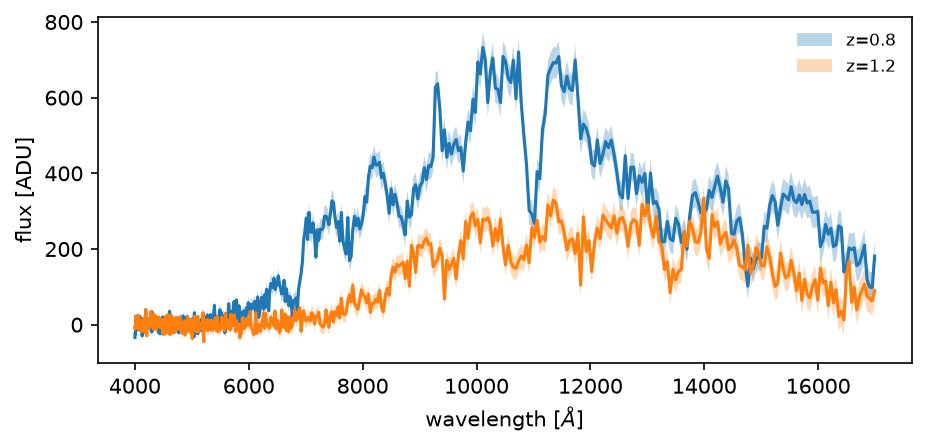
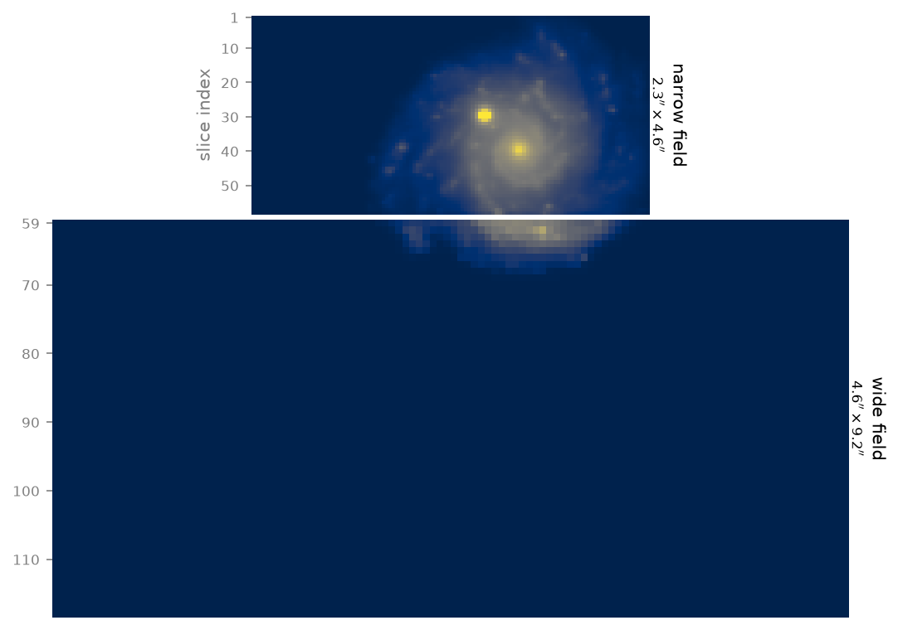
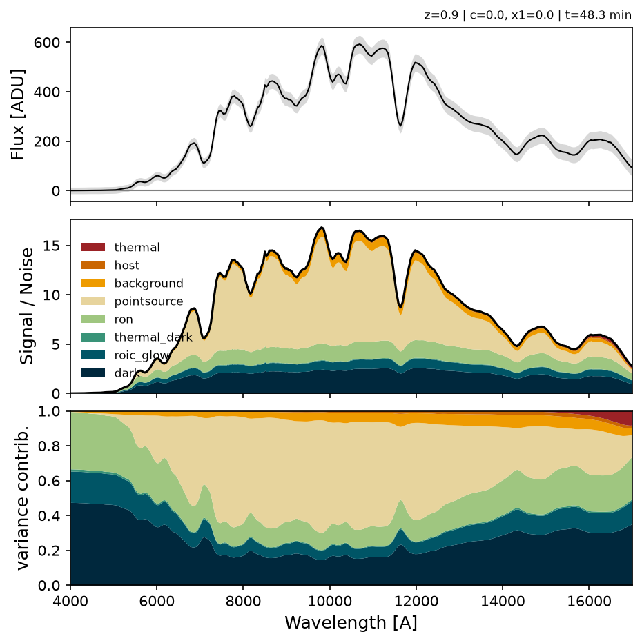

<p align="center">
  
</p>

<p align="center">
  <b>Realistic simulations of integral field spectrograph observations — the Lazuli image slicer simulator.</b>
</p>

<p align="center">
  <a href="https://pypi.python.org/pypi/slicersim"></a>
  <a href="https://slicersim.readthedocs.io/en/latest/?badge=latest"></a>
  <a href="https://github.com/MickaelRigault/slicersim/actions/workflows/ci.yml"></a>
  <a href="https://codecov.io/github/MickaelRigault/slicersim"></a>
</p>

`slicersim` turns a spectrum on the sky into the spectrum you would actually
measure. It propagates a scene through the telescope, the spectrograph and the
detector, adds every noise source, and tells you how long you need to expose to
reach a given signal-to-noise.

It is the reference simulator of the [Lazuli Space Observatory](https://scixplorer.org/abs/2026arXiv260706391R/abstract)
image slicer, but its core is generic and applies to any slicer or micro-lens array IFU.

📖 **Documentation: https://slicersim.readthedocs.io**

- **Exposure time calculator**: exposure time and detector read-out mode to reach a requested signal-to-noise, in one call.
- **Realistic spectra and cubes**: photon, read-out, dark, thermal, background and host noise all accounted for.
- **Built-in sources**: Type Ia supernovae (SALT, Twins Embedding), kilonovae (POSSIS), CalSpec standards, black bodies, power laws, or your own spectrum.
- **Galaxies**: place any source in a host galaxy, or observe a galaxy alone: an analytic Sersic profile or the image and spectrum of a real NGC galaxy, consistently moved to the source redshift.
- **Every knob is accessible**: detector, spectrograph sampling, throughput, scene… and see at once how each noise source contributes.

## Installation

```bash
pip install slicersim
```

Python ≥ 3.10 is required. See the [installation page](https://slicersim.readthedocs.io/en/latest/installation.html) for development installs.

## Exposure time in one line

```python
>>> import numpy as np
>>> import slicersim

```

**Any spectrum**, here a flat spectrum normalised to B = 21 mag:

```python
>>> lbda_ref = np.linspace(3000, 20_000, 500)  # [Å], larger than the Lazuli bandpass
>>> flux_ref = np.ones(lbda_ref.shape)         # flat spectrum
>>> exptime, target = slicersim.lazuli_etc(lbda_ref, flux_ref, snr=20, mag=21, band="bessellb")
>>> print(round(exptime, 2))  # [s]
328.28

```

**A Type Ia supernova** (SALT model):

```python
>>> exptime, snia = slicersim.lazuli_sn_etc(snr=20, model="salt", redshift=1.2, x1=1.5, c=0.2, phase=-2.2)
>>> print(round(exptime, 2))  # [s]
10142.72
>>> snia.get_readout_config()
{'nmd': (64, 8, 0), 'nramps': 7}

```

## Quick look

```python
import slicersim

# a SN Ia (see also LazuliKilonova, LazuliCalSpec, LazuliBlackBody, LazuliTarget(lbda, flux)...)
snia = slicersim.LazuliSupernova(redshift=0.8, c=0.2, x1=-1.2, phase=1.5)

# set the detector read-out to reach a signal-to-noise of 20
_ = snia.setup_to_snr(20)

# the expected observed spectrum
lbda, flux_1, variance_1 = snia.get_spectrum(unit="adu")

# change the target properties
# (the read-out is not updated: this new target will not have snr=20)
snia.change_properties(redshift=1.2)
lbda, flux_2, variance_2 = snia.get_spectrum(unit="adu")
```

and show the simulated spectra:

```python
import matplotlib.pyplot as plt
import numpy as np

fig, ax = plt.subplots(figsize=[7, 3])
for flux, variance, label in [(flux_1, variance_1, "z=0.8"), (flux_2, variance_2, "z=1.2")]:
    ax.plot(lbda, flux)
    ax.fill_between(lbda, flux - np.sqrt(variance), flux + np.sqrt(variance),
                    alpha=0.3, label=label)

ax.legend(frameon=False, fontsize="small")
ax.set(xlabel=r"wavelength [$\AA$]", ylabel="flux [ADU]")
```



## A supernova in its host galaxy

Any target accepts a `host`, named `"spatial:spectral"`: `"sersic:bb-5000"`
(Sersic profile with a 5000 K blackbody spectrum), or a real galaxy such as
`"ngc0628"` (image and spectrum of NGC 0628). The host follows the redshift of
the supernova: its spectrum, brightness (rest-frame `magabs`, default -21) and
angular size (fixed physical size) all change consistently.

```python
import slicersim

sn = slicersim.LazuliSupernova(redshift=0.9, host="ngc0628")

# positions in spaxels from the field center
sn.change_properties(pointsource__position=[+10, +0], host__position=[+20, -10])

# the narrow and wide field cubes, sky switched off, summed over 4000-7000 Å
(cube_narrow, _), (cube_wide, _) = sn.get_cube(switch_off=["background", "thermal"],
                                               psf_profile="airy")
fig = sn.show_cube((cube_narrow, cube_wide), lbda_range=[4000, 7000])
```



The host is a source of flux and noise in the supernova spectrum. Here, the
supernova sits on a spiral arm, where the host contributes about 1% of the
variance (less than the zodiacal background):

```python
_ = sn.setup_to_snr(20)
fig = sn.simulation.show_variance_sources(flux_calibrated=False)
```



The same galaxy can be observed alone, without a supernova:

```python
galaxy = slicersim.LazuliGalaxy(redshift=0.9, model="ngc0628", aperture="2-kpc")
(cube_narrow, _), (cube_wide, _) = galaxy.get_cube(which="both")

# spectrum within 2 kpc of the galaxy center ("core", "<n>-arcsec" or "<n>-kpc")
lbda, flux, variance = galaxy.get_spectrum()
```

## Going deeper: the `Simulation`

Every target is backed by a `Simulation`, which chains a scene (what is
observed), a telescope, a spectrograph and a detector. It gives access to
every parameter and to the origin of the variance:

```python
import slicersim

config = slicersim.get_config(instrument="lazuli_cbe.toml")
sim = slicersim.Simulation.from_config(config)

# set the target you want
sim.update(pointsource__redshift=1.0, x1=0, c=0)

# find the read-out mode reaching a mean SNR of 20 in [4000, 6800] Å rest-frame
new_config, snr, exptime = sim.fetch_snr(20, lbda_range=[4000, 6800], frame="rest")
sim.update(**new_config)

# expected spectrum [ADU] and the contribution of each noise source
lbda, flux, variance = sim.get_spectrum()
fig = sim.show_variance_sources(flux_calibrated=False)
```


`sim.mutable_parameters` lists everything you can change with `sim.update(...)`.

## Tutorials

All tutorials are rendered in the [documentation](https://slicersim.readthedocs.io/en/latest/tutorials.html).

**Beginner**
- [The README examples](https://slicersim.readthedocs.io/en/latest/notebooks/beginner_readme_examples.html): every example and figure of this page.
- [Exposure time calculator](https://slicersim.readthedocs.io/en/latest/notebooks/beginner_ETC_lazulitarget.html): exposure time and spectrum in one call.
- [Lazuli targets](https://slicersim.readthedocs.io/en/latest/notebooks/beginner_LazuliTargets.html): supernovae, CalSpec stars or any spectrum; reach a SNR and get the read-out mode.
- [Changing target properties](https://slicersim.readthedocs.io/en/latest/notebooks/beginner_change_properties.html): redshift, phase, magnitude.
- [Origin of the variance](https://slicersim.readthedocs.io/en/latest/notebooks/beginner_variancesource.html): which noise source dominates.
- [Kilonovae](https://slicersim.readthedocs.io/en/latest/notebooks/beginner_kilonova.html): POSSIS models, viewing angle and phase.
- [Host galaxy](https://slicersim.readthedocs.io/en/latest/notebooks/beginner_host_galaxy.html): a supernova in its host, `"ngc0628"` or `"sersic:bb-5000"`, and redshift consistency.
- [A galaxy alone](https://slicersim.readthedocs.io/en/latest/notebooks/beginner_galaxy.html): `LazuliGalaxy`, its cubes, and its spectrum within an aperture.
- [Populations with `Sample`](https://slicersim.readthedocs.io/en/latest/notebooks/beginner_sample_multiple_targets.html): exposure time and data volume across many targets.

**Advanced**
- [Detector and spectrograph](https://slicersim.readthedocs.io/en/latest/notebooks/advanced_change_detector_and_spectrograph.html) and [MACC read-out modes](https://slicersim.readthedocs.io/en/latest/notebooks/advanced_macc_readout_modes.html)
- [Instrument properties: QE, throughput, spectral resolution](https://slicersim.readthedocs.io/en/latest/notebooks/advanced_access_qe_spectral_resolution_etc.html)
- [Dispersion resolution](https://slicersim.readthedocs.io/en/latest/notebooks/advanced_change_resolution_dispersion.html) and [resolution vs. spot size](https://slicersim.readthedocs.io/en/latest/notebooks/advanced_dispersion_resolution_and_spotsize.html)
- [CalSpec standard stars](https://slicersim.readthedocs.io/en/latest/notebooks/advanced_calspec_and_stdstars.html)
- [Building a scene](https://slicersim.readthedocs.io/en/latest/notebooks/advanced_scene_tutorial.html)

## Citing

If `slicersim` is useful for your work, please cite
[Rigault et al. (2026)](https://scixplorer.org/abs/2026arXiv260706391R/abstract).

## Credits

Developed by M. Rigault, adapted from the original MLAPerf (v0.18.0) developed by Y. Copin and M. Rigault.
Released under the Apache 2.0 license.
