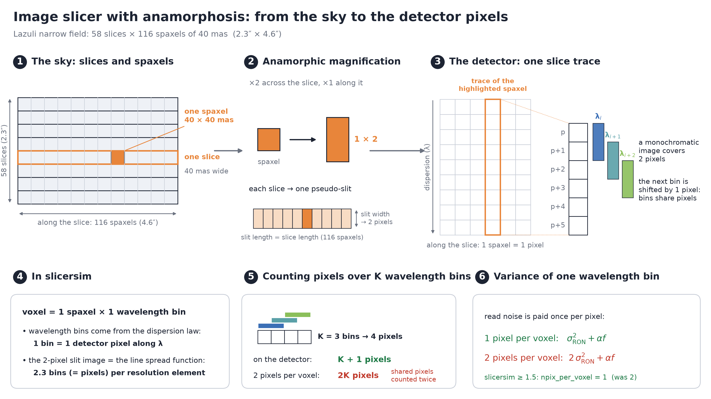

Slicer anamorphosis
===================

This page explains how ``slicersim`` counts detector pixels for an image
slicer, why one voxel is one detector pixel, and how this compares with
`pyetc <https://github.com/RolandBacon/pyetc>`_ (the WST exposure time
calculator). The :doc:`notebooks/advanced_anamorphosis_pixels_per_voxel`
tutorial demonstrates it numerically.

Summary
-------

- A **voxel** is one spaxel × one wavelength bin. For an image slicer, it
  maps to **1 detector pixel**.
- Since version 1.5, ``slicersim`` uses ``npix_per_voxel = 1`` in the
  detector step of slicer spectrographs
  (:meth:`~slicersim.detector.Detector.estimate_pixel_signal`, called by
  ``Simulation._get_slicer_cube_``). This is also what pyetc does.
- Up to version 1.4, the parameter was called ``npix_per_spaxel`` and was
  set to the anamorphosis factor, ``_ANAMORPHOSE = 2``. This doubled the
  detector variance (read noise, dark current, ROIC glow, thermal dark) of
  every voxel, and so underestimated the signal-to-noise ratio of
  detector-limited observations (see `Impact`_).

.. important::

   The anamorphosis is already counted in the width of the spectral
   resolution element (the line spread function, ``dispersion_resolution``
   ≈ 2.3 pixels). Counting it again as extra pixels per voxel counts it
   twice.

         imaged onto 1 × 2 detector pixels, 1 along the slice and 2 along the
         dispersion; consecutive wavelength bins are shifted by one pixel and
         share pixels.
   :align: center

   From the sky to the detector pixels. Over *K* wavelength bins, a spaxel
   trace covers *K* + 1 pixels, not 2\ *K*. (Script:
   ``docs/gallery/make_anamorphosis_schematic.py``.)

What an image slicer's anamorphosis does
----------------------------------------

A slicer cuts the field into slices. Each slice is re-imaged as a pseudo-slit
at the spectrograph entrance.

- **Along a slice** (the spatial axis on the detector), 1 pixel samples
  1 spaxel.
- **Across a slice**, the slice width becomes the slit width. With no
  anamorphosis, a square spaxel would be imaged onto about 1 pixel in the
  dispersion direction, and the spectrum would be under-sampled. The slicer
  optics therefore stretch the image across the slices by a factor *A*
  (typically 2, as in MUSE-like designs). The slit is then *A* pixels wide in
  the dispersion direction.

A monochromatic voxel image therefore covers **1 pixel along the slice ×**
***A* pixels along the dispersion**. Those *A* pixels are the spectral
resolution element (the LSF), and neighbouring wavelengths share them.

- With a spectral sampling of 1 wavelength bin = 1 pixel, each voxel
  ``(spaxel, wavelength bin)`` maps to **exactly 1 detector pixel**.
- A full resolution element of one spaxel covers *A* pixels.
- The source and sky photons are conserved either way.

So the anamorphosis shows up in three places only:

- the LSF width in pixels: ``lsfpix = 2.5`` in pyetc,
  ``dispersion_resolution`` ≈ 2.3–2.5 in ``slicersim``;
- the detector footprint;
- the noise per resolution element (*A* pixels, through the LSF).

It does **not** show up as extra pixels per wavelength bin.

``slicersim``'s PSF model makes the same assumption.
:meth:`~slicersim.spectrograph.Spectrograph.get_instrumental_psf` takes the
"expected geometric footprint" of the slit to be ``expected_size = 2``
pixels, and divides the extra blur by ``_ANAMORPHOSE`` to turn detector
pixels into slice widths.

How ``slicersim`` does it
-------------------------

The wavelength grid is built from the dispersion law, **one bin per detector
pixel** (``build_lbda``): for Lazuli, 4 000–17 000 Å spans 524 pixels and
gives 525 wavelength bins. The 2 pixels of the slit image are the line spread
function, applied to the cube with ``dispersion_resolution = 2.3`` pixels per
resolution element.

The detector step then spreads the flux of each voxel over
``npix_per_voxel`` pixels, computes the signal and the variance per pixel,
and sums them back per voxel:

.. code-block:: python

   # Simulation._get_slicer_cube_
   sig_cube, var_cube = self.detector.estimate_pixel_signal(cube, lbda=lbda,
                                                            npix_per_voxel=1,
                                                            cached_thermal=cached)

For a voxel receiving *f* e⁻/s, an up-the-ramp read-out gives the variance
:math:`\mathrm{Var} = n_\mathrm{pix}\,\sigma^2_\mathrm{RON,eff} + \alpha f`
(Rauscher et al. 2007). The photon noise :math:`\alpha f` does not depend on
:math:`n_\mathrm{pix}`, but the read noise is paid once per pixel. With
``npix_per_voxel = 1``, an empty voxel has the read noise of exactly one
pixel; this is tested in ``tests/test_simulation.py``
(``test_slicer_one_pixel_per_voxel``).

Independent check with the optical design
^^^^^^^^^^^^^^^^^^^^^^^^^^^^^^^^^^^^^^^^^

The spot data of the Lazuli optical design
(:class:`~slicersim.mapper.SlicerMapper`) gives:

- **along a slice**, 105–108 detector pixels for the 116 spaxels of a slice;
- for an emission line at 1.2 µm, a footprint of 320 voxels falls on 383
  detector pixels, i.e. **1.2 pixels per voxel**, not 2. The extra 0.2 comes
  from the dispersion: at 1.2 µm, one ``slicersim`` wavelength bin is about
  1.2 pixels of the spot-data dispersion.

A Monte Carlo that draws the noise of each of these detector pixels gives an
SNR of 7.8 for that line. With 1 pixel per voxel, ``slicersim`` gives 8.4;
with 2 pixels per voxel, it gave 6.0.

The spaxel grid
^^^^^^^^^^^^^^^

:meth:`SlicerSpectrograph.set_spaxels
<slicersim.spectrograph.SlicerSpectrograph.set_spaxels>` multiplies the
number of spaxels along the slices by ``_ANAMORPHOSE`` and keeps the spaxel
scale:

.. code-block:: python

   shape = np.asarray(shape) * (1, self._ANAMORPHOSE)
   spx_scale = np.asarray(spx_scale)

For Lazuli, ``spatial_shape = [58, 58]`` and ``spatial_scale = 0.040″`` give
58 slices × 116 spaxels of 0.040″ × 0.040″, a field of 2.32″ × 4.64″. Each
grid element is a full square spaxel, imaged onto one pixel along the slice,
so this grid is consistent with ``npix_per_voxel = 1``. Whether it matches
the actual Lazuli field of view is a question for the optical design, and is
left unchanged in version 1.5.

Before commit ``07ff099`` ("major refactoring of the way anamorphose is taking
into account"), the code was ``shape * (2, 1)`` together with
``spx_scale / (2, 1)``, which kept a 2.32″ × 2.32″ field.

.. warning::

   If the grid is ever changed to split spaxels (scale divided by
   ``_ANAMORPHOSE`` along one axis), each grid element becomes half a
   spaxel. The number of pixels per *grid element* must then stay 1 (so 2
   pixels per spaxel along the slice, if the design really is so); it must
   never be combined with ``npix_per_voxel = 2``, which would charge **4**
   pixels per spaxel.

pyetc
-----

The detector noise is per voxel, and ``nb_voxels`` counts spaxels × spectels.
See `etc.py#L918-L919
<https://github.com/RolandBacon/pyetc/blob/e6e351ebf928d98adad34e8d17e5825b15595bc9/pyetc/etc.py#L918-L919>`_,
which is repeated at L973, L1028 and L1085:

.. code-block:: python

   ron_noise = np.sqrt(ins['ron']**2*nb_voxels*obs['ndit'])
   dark_noise = np.sqrt(ins['dcurrent']*nb_voxels*obs['ndit']*obs['dit']/3600)

The anamorphosis enters only through ``lsfpix = 2.5`` (`wst.py#L48
<https://github.com/RolandBacon/pyetc/blob/e6e351ebf928d98adad34e8d17e5825b15595bc9/pyetc/wst.py#L48>`_).
This is the convention ``slicersim`` follows since version 1.5.

Impact
------

Setup: the default ``LazuliTarget``, a flat :math:`F_\lambda`, optimal
extraction, noise-free spectrum, with 2 pixels per voxel (``slicersim`` ≤ 1.4)
or 1 pixel per voxel (``slicersim`` ≥ 1.5). Everything else is unchanged.

.. list-table::
   :header-rows: 1

   * - :math:`F_\lambda` [erg/s/cm²/Å]
     - pixels per voxel
     - SNR 5000 Å
     - SNR 10000 Å
     - SNR 15000 Å
   * - 3e-18
     - 2 (≤ 1.4)
     - 2.72
     - 19.91
     - 24.69
   * - 3e-18
     - 1 (≥ 1.5)
     - 3.43 (+26 %)
     - 21.42 (+8 %)
     - 26.77 (+8 %)
   * - 3e-17
     - 2 (≤ 1.4)
     - 15.06
     - 73.78
     - 93.07
   * - 3e-17
     - 1 (≥ 1.5)
     - 16.05 (+7 %)
     - 74.83 (+1 %)
     - 94.61 (+2 %)

Exposure time for a Type Ia supernova at peak to reach SNR = 20
(``LazuliSupernova(redshift=z).setup_to_snr(20)``):

.. list-table::
   :header-rows: 1

   * - Redshift
     - 2 pixels per voxel (≤ 1.4)
     - 1 pixel per voxel (≥ 1.5)
     - Ratio
   * - 0.5
     - 883 s
     - 792 s
     - 1.11
   * - 1.0
     - 3 668 s
     - 2 898 s
     - 1.27
   * - 1.5
     - 17 388 s
     - 11 592 s
     - 1.50

- **Detector-limited cases** (faint, distant sources, the blue end where
  the read noise dominates) are the most affected: the former behaviour
  underestimated the SNR by up to about 25 %, and overestimated exposure
  times by up to about 1.5×.
- **Photon-limited cases** change by only a few percent.

Ground-based slicers and WST
----------------------------

Ground-based slicer IFSs are simulated by the `slicersim-ground`_ add-on.
Its ``GroundSlicerSpectrograph`` subclasses
:class:`~slicersim.spectrograph.SlicerSpectrograph` with
``_ANAMORPHOSE = 1``: the spaxel grid is the configured one, with the
anamorphosis in the LSF (``dispersion_resolution``, a FWHM in pixels).
It already used 1 pixel per voxel before version 1.5, since the number of
pixels per voxel was then taken from ``_ANAMORPHOSE``; it is now 1 for every
slicer.

This is the pyetc convention. With the WST IFS configurations of the add-on
(25 × 25 spaxels of 0.25″, LSF of 2.5 pixels FWHM), it reproduces pyetc's
resolved-source SNR to 1e-4.

.. _slicersim-ground: https://gitlab.in2p3.fr/ycopin/slicersim-ground
