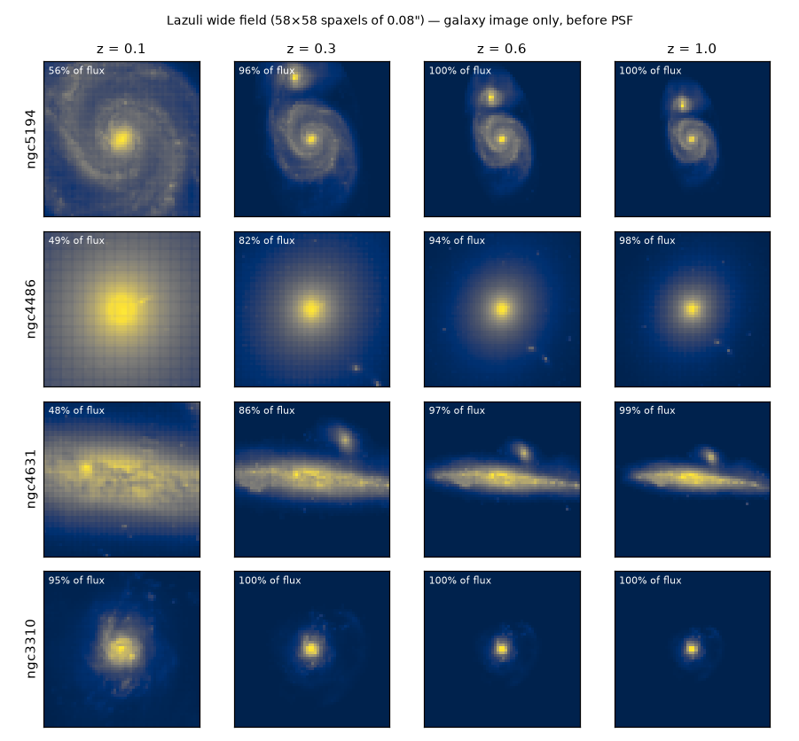
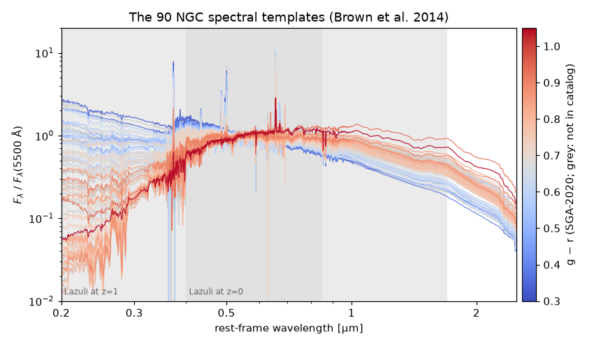

Host galaxy models
==================

A host galaxy (`~slicersim.scene.host.Host`) is a spectrum times an image. Its
model is named ``"spatial:spectral"``, and each part is either analytic or
taken from a real nearby galaxy:

.. list-table::
   :header-rows: 1
   :widths: 18 40 42

   * - Part
     - Analytic
     - Real galaxy (NGC)
   * - **spatial**
     - ``sersic``: Sersic profile, physical size ``r_kpc`` (default 5),
       ``n=2``, ``ellip=0.3``, ``theta=-30``.
     - ``ngcXXXX``: r-band image of the galaxy (63 available).
   * - **spectral**
     - ``bb`` or ``bb-<T>``: black body of temperature ``T`` [K]
       (default 5000).
     - ``ngcXXXX``: spectral template of the galaxy (90 available).

A bare NGC name is the image *and* the spectrum of that galaxy
(``"ngc0628"`` is ``"ngc0628:ngc0628"``); parts can be mixed freely, e.g.
``"sersic:ngc4552"`` (smooth profile, elliptical-galaxy spectrum) or
``"ngc5194:bb-6000"``. Names are case insensitive.

.. code-block:: python

   import slicersim

   sn = slicersim.LazuliSupernova(redshift=0.5, host="ngc5194")          # image + spectrum
   sn = slicersim.LazuliSupernova(redshift=0.5, host="sersic:ngc3627")   # spectrum-only galaxy
   sn = slicersim.LazuliSupernova(redshift=0.5,
                                  host={"refmodel": "ngc4552", "magabs": -22,
                                        "position": (5, -3), "rotation": 30})

Whatever the model, the host brightness is set by ``magabs`` (default -21,
rest-frame ``sdssr``), and it takes the redshift of the point source. See
`~slicersim.scene.host.get_host_config` for all parameters and
:doc:`concepts` for the scene.

.. note::

   The NGC data come from the ``lazuli_astrosim_data`` package: r-band images
   from the DESI Legacy Surveys (DR10), with redshifts and sizes from the
   Siena Galaxy Atlas (SGA-2020), and spectral templates from the
   `Brown et al. (2014) <https://ui.adsabs.harvard.edu/abs/2014ApJS..212...18B/abstract>`_
   atlas of galaxy SEDs.

What to look at when choosing
-----------------------------

**Size.** An NGC image keeps the *physical* size of the galaxy: its image is
rescaled from the galaxy's own (tiny) redshift to the simulated one. At low
redshift a large galaxy overfills the field: only its central part is
simulated. The semi-major axis (SMA, at 26 mag/arcsec² in r) gives the
order of magnitude: Lazuli's wide field is 4.6\" across, i.e. about 9 kpc at
z = 0.1, 21 kpc at z = 0.3 and 38 kpc at z = 1.

         Lazuli wide field at redshifts 0.1, 0.3, 0.6 and 1.0, with the
         fraction of the galaxy flux inside the field.
   :align: center

   Four galaxies in the Lazuli wide field at increasing redshift (image
   only, before PSF; the label is the fraction of the galaxy flux in the
   field). At the lowest redshifts the galaxy image pixel is close to the
   spaxel size and the resampling can leave a faint grid pattern
   (NGC 4486 at z = 0.1).

**Spectrum.** The templates go from passive ellipticals (red, strong 4000 Å
break, no emission lines) to star-forming and starburst galaxies (blue,
strong emission lines); the g − r colour sorts them. All templates span
0.01–35 µm rest-frame, so they cover the Lazuli range (0.4–1.7 µm) at any
redshift.

         coded by g-r, with the rest-frame range observed by Lazuli at
         z = 0 and z = 1.
   :align: center

   All spectral templates, normalised at 5500 Å and colour coded by g − r.
   The shaded areas are the rest-frame ranges observed by Lazuli at z = 0
   and z = 1.

Gallery: image and spectrum
---------------------------

These 63 galaxies have both an image and a spectrum: use their bare name
(but see :ref:`galaxy-known-issues` for the cards marked in orange).
Each card shows the r-band image (with a 10 kpc bar) and the rest-frame
spectrum (0.2–2.5 µm, log scale).

.. include:: gallery/galaxies/cards_full.inc

Gallery: spectrum only
----------------------

These 27 galaxies have a spectral template but no image: combine them with a
``sersic`` profile (or another galaxy's image), e.g. ``"sersic:ngc3627"``.

.. include:: gallery/galaxies/cards_spectrum.inc

All galaxies
------------

The model name is the recommended one: the bare name when both parts work,
otherwise the part that works with an analytic one. Own redshift and SMA are
those of SGA-2020 (– if the galaxy is not in the catalogue shipped with
``lazuli_astrosim_data``); the SMA is converted to kpc at the galaxy's own
redshift, as ``slicersim`` does to rescale the image.

.. include:: gallery/galaxies/table.inc

.. _galaxy-known-issues:

Known issues
------------

Every model of this page is tested when the page is built; those that fail
are flagged in orange in the gallery and in the *Note* column above.

- **17 spectral templates fail** (``ValueError: wavelength must be
  monotonically increasing``), mostly early-type galaxies, e.g. NGC 4486
  (M87). The templates are fine, but their wavelength sampling is irregular,
  and ``sncosmo.Spectrum``, used to normalise the magnitude in
  `~slicersim.scene.sources.generic.generic_get_flux`, fails to rebuild
  their bin edges. Meanwhile, use the galaxy image with another spectrum,
  e.g. ``"ngc4486:bb-5000"`` or ``"ngc4486:ngc4552"``.
- **NGC 4569 image**: the galaxy is blueshifted (z = -0.0007), so its image
  cannot be rescaled to another redshift and gives an empty host. Use its
  spectrum only, ``"sersic:ngc4569"``.

The figures and tables of this page are produced by
``docs/gallery/make_galaxy_gallery.py``; re-run it after any change of
``lazuli_astrosim_data``.
